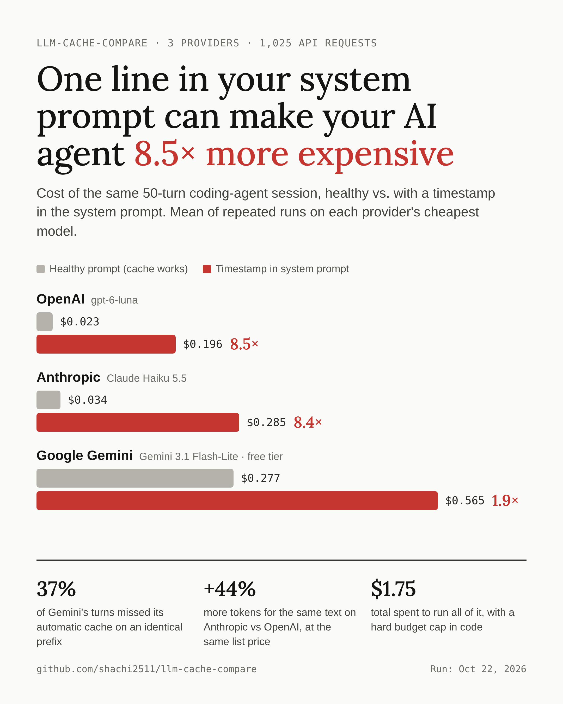
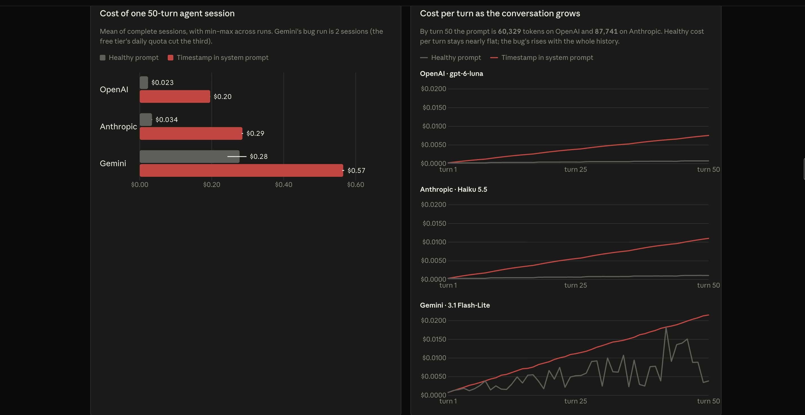
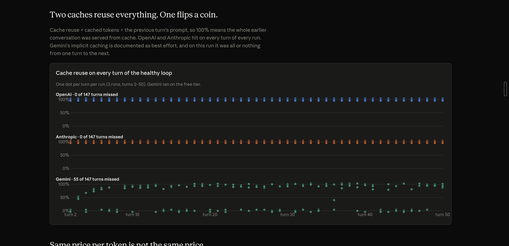
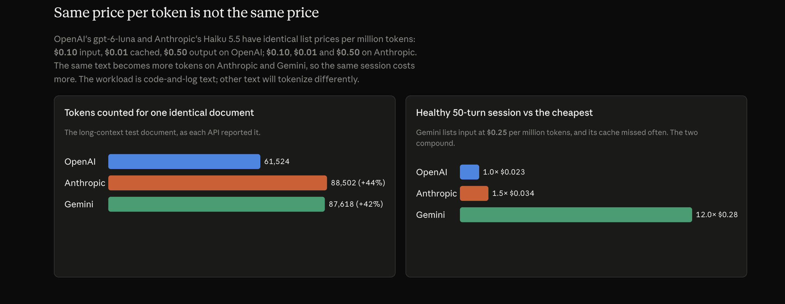
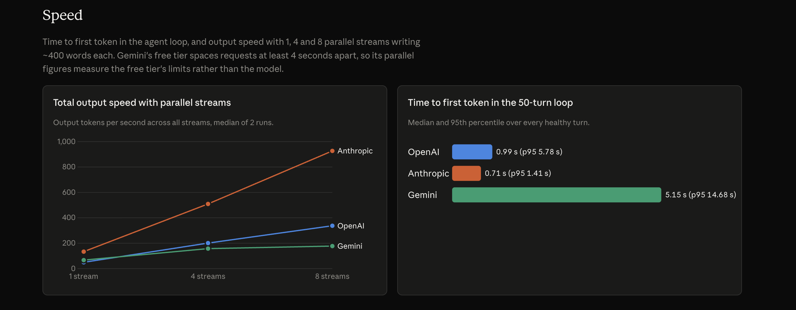
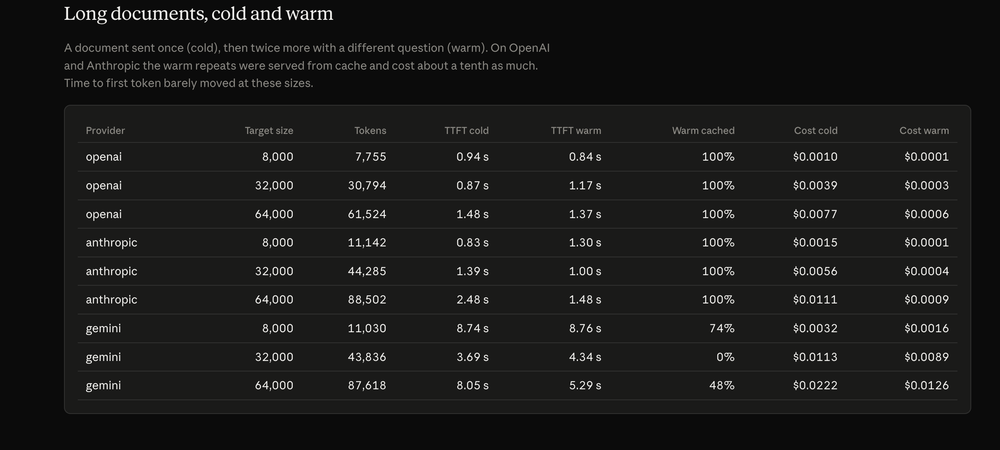

# llm-cache-compare

**The same AI-agent workload on OpenAI, Anthropic and Google Gemini: what prompt caching really saves, and what breaks it.**

[](https://github.com/shachi2511/llm-cache-compare/actions/workflows/ci.yml)

[](LICENSE)

**3 providers · 1,025 API requests · 3 runs per test · 13 tests · $1.75 spent**



A spin-off of [AgentLoad](https://github.com/shachi2511/agentload), my agent-workload benchmark. AgentLoad found that a timestamp in the system prompt made an agent 7.8× more expensive on one provider. This project asks: does it happen everywhere?

## Why caching matters for agents

An AI agent re-sends the entire conversation on every step. By step 50 that's tens of thousands of tokens per request. Prompt caching bills text the provider has already seen at about a tenth of the price, so you mostly pay for what's new.

Caching only works if the **start** of the prompt is identical to last time. The provider matches from the first token and stops at the first difference; everything after it is billed at full price.

```text
❌ "Time: 4:15:02. You are a coding assistant…"   ← differs on line 1, nothing is cached
✅ "You are a coding assistant… (time: 4:15:09)"  ← same start, only the end is new
```

## Findings

Each provider's cheapest current model (OpenAI gpt-6-luna, Anthropic Claude Haiku 5.5, Google Gemini 3.1 Flash-Lite), through its native API with its documented caching on. A 50-turn coding-agent loop, 3 runs each, Oct 22, 2026. Costs are each API's reported token counts × list price.

- **A timestamp in the system prompt made the same session 8.5× more expensive on OpenAI and 8.4× on Anthropic,** within 2% across runs. On Gemini it was 1.9×, because its cache was already missing often.
- **Same price per token, different bill.** OpenAI and Anthropic list identical prices, but Anthropic counted the same text as 44% more tokens, so the same session cost 48% more.
- **Gemini's automatic cache missed 37% of turns** (55 of 147) on an identical prefix. OpenAI and Anthropic reused ~100% of the previous turn every time.
- **Cost of one healthy 50-turn session:** OpenAI $0.023, Anthropic $0.034, Gemini $0.277 (list price).
- **Speed:** Anthropic streamed ~165 tokens/s per request and ~930 tokens/s across 8 parallel requests; OpenAI ~340 at 8.
- **Long documents:** warm repeats of an 8K–64K-token document cost about a tenth of the cold request on OpenAI and Anthropic.

**The fix is free:** keep anything that changes (time, user or session data, request IDs) at the end of the prompt, never the start.

→ [Summary](report/summary.json) · [Raw logs](results/compare/) · every chart below is built from these files

## Results in charts

**One line in the system prompt multiplies the bill.** Cost of a whole 50-turn session (left) and of each turn as the conversation grows (right). With caching, cost per turn stays nearly flat; with the timestamp bug it climbs with the whole history.



**Two caches reuse everything. One flips a coin.** Share of the previous turn served from cache, every turn of every run. OpenAI and Anthropic sit at 100%; Gemini jumps between ~0% and ~100%.



**Same price per token is not the same price.** The same document is 44% more tokens on Anthropic than on OpenAI, at identical list prices.



**Speed.** Total output speed with 1, 4 and 8 parallel requests, and time to first token in the agent loop.



**Long documents, cold and warm.** On OpenAI and Anthropic, repeat requests for the same 8K–64K-token document were fully cached and cost about a tenth as much.



## Run it yourself

```bash
git clone https://github.com/shachi2511/llm-cache-compare && cd llm-cache-compare
python -m venv .venv && source .venv/bin/activate
pip install -e ".[dev]"
python -m pytest -q                            # 13 tests against fake APIs: free, no keys

# keys go in .env (git-ignored): OPENAI_API_KEY=..., ANTHROPIC_API_KEY=..., GEMINI_API_KEY=...
python -m llm_cache_compare.compare --dry-run  # 2 tiny requests per provider: key works? cache hit? cost estimate
python -m llm_cache_compare.compare            # full run, providers in parallel (~$4 at list price, hard cap $10)
python -m llm_cache_compare.report             # -> report/summary.json + a comparison table
```

| Test | What it measures |
|---|---|
| `loop_healthy` | 50-turn coding-agent loop with a stable system prompt: cost per turn, cache reuse, time to first token |
| `loop_bug` | the identical loop with a fresh timestamp in the system prompt on every request |
| `long_context` | 8K / 32K / 64K-token documents, sent cold then twice warm: cache hits, cost, time to first token |
| `concurrency` | 1 / 4 / 8 parallel streams writing ~400 words: tokens per second per stream and in total |

## How it works

- **Native APIs, no SDKs.** [`adapters.py`](llm_cache_compare/adapters.py) speaks OpenAI Responses, Anthropic Messages, Gemini generateContent and OpenAI-compatible Chat Completions over plain HTTP + server-sent events, so each provider's caching behaves as designed and every usage field is visible. Usage is normalized so "cached ÷ prompt" means the same thing everywhere.
- **Cache reuse, not hit rate.** Reuse = cached tokens ÷ the previous turn's prompt. It stays near 100% when caching works and drops to ~0% when it breaks, unlike hit rate, which drifts as the conversation grows.
- **Costs from token counts.** Most APIs don't return a charge, so cost = reported tokens × list price from [`providers.yaml`](providers.yaml), including cache-write premiums (1.25× on OpenAI and Anthropic) and Haiku's long-context tier.
- **A budget guard that can't overspend.** Before every request it reserves the worst-case cost against a per-provider cap and a lifetime cap, then settles to the real cost.
- **Fair settings.** Reasoning off where possible (OpenAI effort none, Anthropic thinking disabled, Gemini thinking low). Requests that share a document send it as its own block so every provider can cache it.
- **Every number traces to a log line.** Each request is one JSONL line in [`results/`](results/compare/); [`report.py`](llm_cache_compare/report.py) rebuilds the summary, and CI re-checks it on every push.

<details>
<summary><b>Things I had to work out along the way</b></summary>

- **Anthropic and OpenAI cache at block boundaries.** A document and a question glued into one message never cached on the repeat. Sending the document as its own block (with an explicit breakpoint) fixed it on both.
- **Anthropic's OpenAI-compatible endpoint doesn't support caching**, so the tool calls the native Messages API.
- **Gemini only caches prompts above ~4K tokens**, reuses part of a prefix, and doesn't put rate-limit wait times in a header (they're in the error body as `retryDelay`).
- **Claude Haiku 5.5 thinks by default.** It spent ~90 hidden tokens to answer "YES" until thinking was turned off.
- **Free tiers throttle long prompts.** The client paces requests, honors server-provided wait times, and counts every retry instead of hiding it.

</details>

## Limits

- **One night's run** (Oct 22, 2026, US Central). Speed and cache behavior vary with load and may change.
- **Gemini ran on the free tier:** requests paced 4 s apart, 6 of 319 failed on rate limits. Its latency and parallel speed reflect free-tier limits, and paid-tier caching may differ.
- **Synthetic text** (test output, diffs, logs). Token counts and caching on your own prompts will differ.
- **List-price costs, not invoices.** Gemini's figures are what the same tokens would cost on the paid tier.

## License

[MIT](LICENSE) © 2026 Shachi Shriwastava
